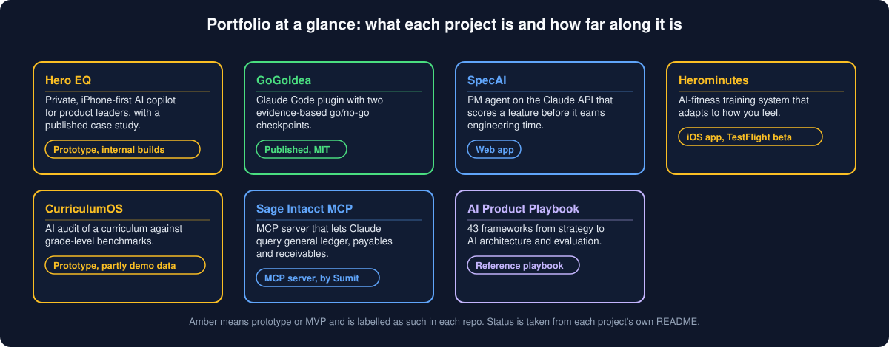
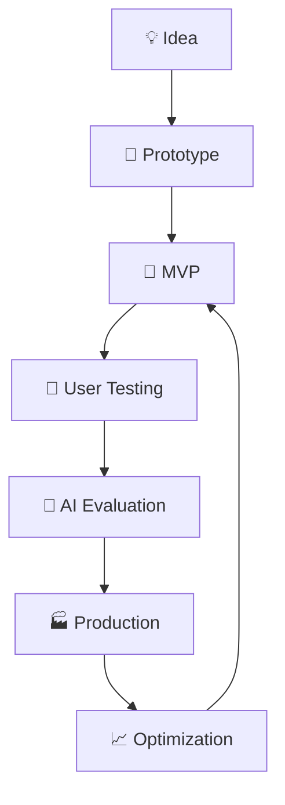
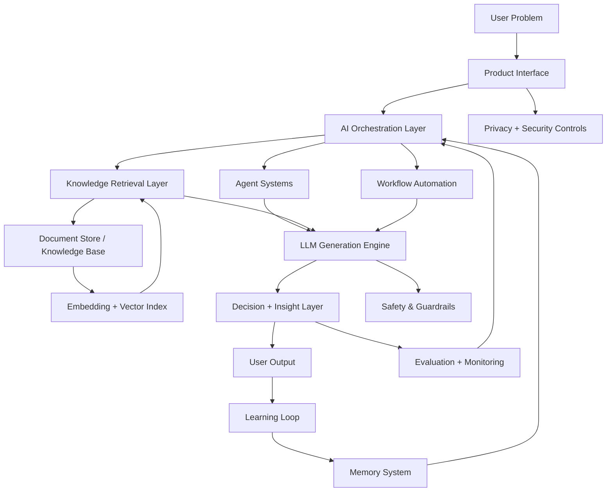
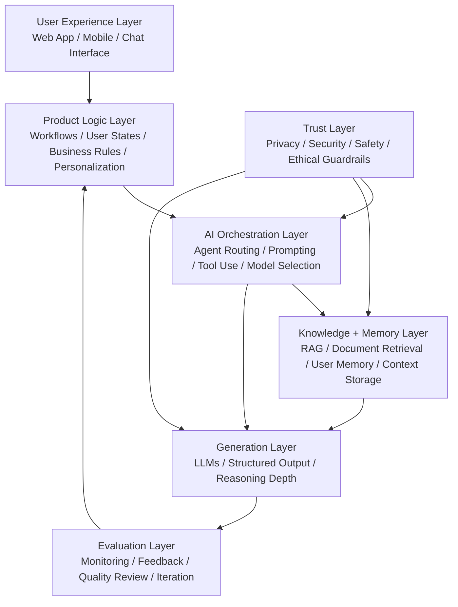
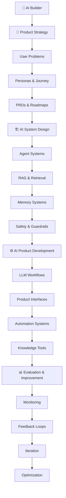

# Hi, I'm Jamil · Senior Product Manager and AI product builder

**I decide what to build, prove it with working prototypes, and set the evaluation bar before launch.** I'm a hands-on product leader who ships AI products in public, with the evidence behind each decision on the page.

**Open to remote roles, full-time or fractional:** Senior and Staff Product Manager, AI Product Manager, and fractional AI product leadership for early-stage teams.

[LinkedIn](https://www.linkedin.com/in/jambuilds) · Building under the name **Hero Minutes**

### Start here (two minutes)

| A product case study | A tool I built | My methodology |
|---|---|---|
| [**Hero EQ**](https://github.com/herominutes/hero-eq): a prototype iPhone copilot for product leaders, with the evidence, strategy and lessons | [**GoGoIdea**](https://github.com/herominutes/gogoidea): a Claude Code plugin for evidence-based go/no-go decisions | [**AI Product Builder Playbook**](https://herominutes.github.io/ai-product-builder-playbook/): 43 frameworks from strategy to AI evaluation |

---

## What I bring

| | |
|---|---|
| **Product judgment** | I decide what not to build. My tools force a clear "no" when the evidence is thin, and I name the opportunity cost of every yes. |
| **AI product craft** | I design AI features as systems: retrieval, orchestration, guardrails and evaluation, not a single prompt. |
| **Builder credibility** | I ship working prototypes myself, so I can scope with engineers honestly and test ideas before a roadmap commitment. |
| **Operating rigour** | Before anything is built I put the problem, the success metrics and the kill criteria in writing, so a "no" is cheap and a "yes" is defensible. |

---

## Featured work

### Hero EQ: a private AI copilot for product leaders
[Hero EQ](https://github.com/herominutes/hero-eq) (formerly PocketPM) is an iPhone-first AI copilot for product leaders, documented as a case study.
- **Problem:** decisions made out loud lose their reasoning, status updates take hours, and confidential work does not belong in a public chatbot.
- **Approach:** an evidence study before building, a focus pass that cut 27 specialists to 12, and privacy claims limited to what the build can back.
- **Status:** a prototype on internal builds with one user and no external testers yet. The case study says what was verified and what was not.

### GoGoIdea: decisions that have to show their evidence
[GoGoIdea](https://github.com/herominutes/gogoidea) is a Claude Code plugin with one command, `/hero:gogoidea`, and two checkpoints: **what to build**, and **whether to ship**.
- **Problem:** teams make both calls on instinct, and an average score can hide one critical flaw.
- **Approach:** isolated reviewers score blind, scripts verify quotes, files, lines and counts, and any open critical issue means No-Go however good the average looks.
- **What I learned:** my own testing caught ten defects in my design, including a reviewer's wrong "0 matches" claim. The [case study](https://github.com/herominutes/gogoidea/blob/main/docs/CASE-STUDY.md) lists each one and the fix.

### SpecAI: a quality gate between an idea and the roadmap
[SpecAI](https://github.com/herominutes/pm-spec-ai) is a PM agent built on the Claude API that scores a feature's defensibility before it earns engineering time.
- **Problem:** features are approved on seniority and gut feel, with no baseline metrics and only anecdotal customer evidence.
- **Approach:** a five-phase flow with a hard gate at 75/100, at least three direct customer quotes, a pre-mortem, forced ranking against the live roadmap, and a post-launch loop that feeds learnings back in.

### Herominutes: AI recovery guidance for athletes
[Herominutes](https://github.com/herominutes/herominutes-app) is a mobile-first PWA for injury recovery and mobility, with daily pain check-ins that adapt the guidance.
- **Problem:** recovery is scattered across notes and rehab sheets, with low adherence.
- **Approach:** structured recovery workflows, adaptive AI guidance, and progress mechanics to keep people consistent.

### CurriculumOS: an AI audit of any curriculum
[CurriculumOS](https://github.com/herominutes/curriculum-audit-engine) scores a curriculum against what students at a grade, place and year should know.
- **Honest scoping:** the README states what is live and what is demo data. I label prototypes as prototypes.

### Sage Intacct MCP: Claude connected to financial data
[sage-intacct-mcp](https://github.com/herominutes/sage-intacct-mcp) is an MCP server that lets Claude run general ledger, payables, receivables and financial statement queries. **Written by Sumit**, and hosted on my account.

---

## How I think about AI products

1. **User problems before model choice.** Start with the real workflow. AI is a capability, not the product. *See: Herominutes, CurriculumOS.*
2. **Systems over features.** An AI product is models, data, orchestration, evaluation and feedback loops. *See: GoGoIdea.*
3. **Ground it, then generate.** Retrieve verified sources before generating, and verify what comes back. *See: GoGoIdea checks every quote against its source.*
4. **Evaluation is a product feature.** Build the test before you trust the output. *See: SpecAI's scored gate, GoGoIdea's scripts.*
5. **Guardrails are architecture.** Privacy, safety and read-only defaults are design decisions. *See: GoGoIdea never edits the repo it reviews and masks secrets it finds.*
6. **Human in the loop where it counts.** People approve what ships. *See: SpecAI's PM approve or reject step.*
7. **Agents need orchestration.** Clear roles, isolated context, a chair that decides. *See: GoGoIdea's reviewers and chair.*
8. **Strategy drives AI design.** Model capability serves the product outcome, never the reverse.

---

## My product lifecycle

<b>AI system architecture I design toward</b>

<b>The layered AI product stack</b>

<b>Capability map</b>

---

## The playbook

The [AI Product Builder Playbook](https://herominutes.github.io/ai-product-builder-playbook/) holds 43 frameworks across strategy, discovery, AI architecture and evaluation, planning and documentation, execution, leadership and learning. It is the methodology behind the projects above.

---

**Tools:** Claude Code, Anthropic and OpenAI APIs, Supabase, React and TypeScript, Python
